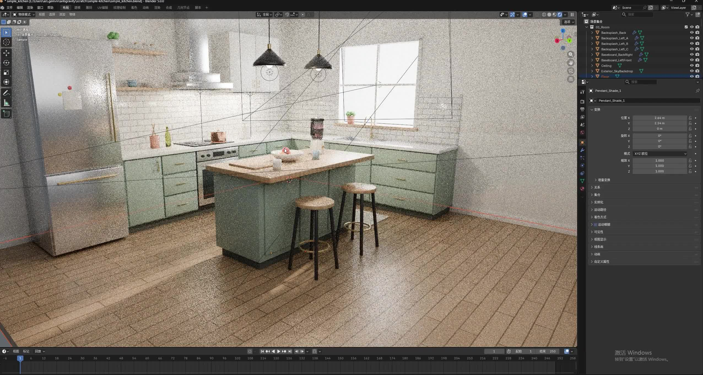

# Blender 全自动 3D 厨房场景

用 Google 反重力（Antigravity）里的 Claude 调用本地 Blender，从零自动搭建温馨写实 3D 厨房，并输出可编辑的 `.blend` 工程和高清光追渲染图。

适用：Blender 5.0+（`blender --background --python` 全自动构建）。温馨写实、日式原木、法式乡村或现代轻奢厨房等风格，都可以在提示词里替换。

演示画面：

- 视频：[media/kitchen-demo.mp4](media/kitchen-demo.mp4)
- 原帖：[@Mulight 的 X 分享](https://x.com/Mulight/status/2125418681773838590)

## 怎么用

1. 本地安装 [Blender 5.0+](https://www.blender.org/download/)。
2. 打开 [PROMPT.md](./PROMPT.md)，复制「一、可直接复制使用的完整提示词」整段。
3. 把这段提示词发给反重力 / Claude，让它通过 `blender.exe --background --python`（或其他系统上的 Blender 可执行文件）在后台执行 Python 脚本。

提示词会要求 AI 按 5 个阶段执行：米制空间布局、精细建模与 Blender 5.0 节点防报错、三层冷暖布光与双机位、Cycles GPU 光追，以及渲染看图自检后再交付 `.blend`、构建脚本和预览图。

## 仓库里有什么

- [PROMPT.md](./PROMPT.md) — 完整提示词，以及风格/角色 IP/竖屏封面等变体替换建议
- [media/kitchen-demo.mp4](media/kitchen-demo.mp4) — 演示视频
- [media/kitchen-poster.jpg](media/kitchen-poster.jpg) — 预览图

本仓库按 MIT License 开源。
